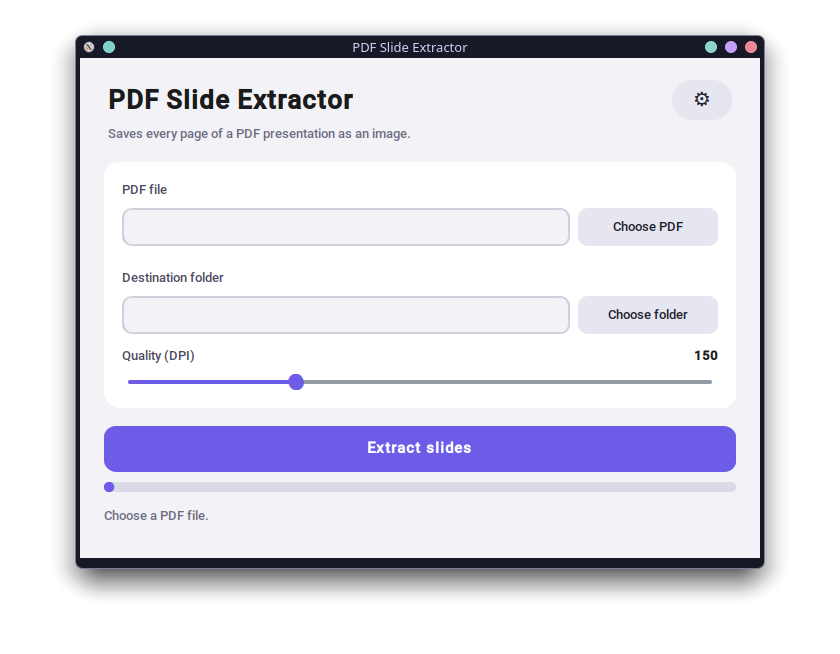

# PDF Slide Extractor

A small desktop app that saves every page of a PDF presentation as a separate image.



## Features

- Extracts each page of a PDF to **PNG**, **JPG** or **JPEG**
- Output goes into a newly created `<pdf name>_extracted/` folder (never overwrites existing ones)
- Adjustable quality (50–400 DPI)
- Fast: pages are rendered in parallel across all CPU cores
- Native file/folder pickers (Windows, macOS, Linux via `zenity` or `kdialog`)
- English / Slovak interface and dark / light theme, selectable from the ⚙ menu (saved between runs)

## Requirements

- Python 3.9+ with Tkinter
- [PyMuPDF](https://pymupdf.readthedocs.io/) and [CustomTkinter](https://github.com/TomSchimansky/CustomTkinter)

On Linux, install Tkinter and, optionally, a native dialog tool (`zenity` or `kdialog`) from your package manager.

## Installation

```bash
git clone <repository-url>
cd PDFExtractor
python -m venv .venv
source .venv/bin/activate        # Windows: .venv\Scripts\activate
pip install -r requirements.txt
```

## Usage

```bash
python pdf_extractor.py
```

1. Choose a PDF file.
2. Choose the destination folder (defaults to the PDF's folder).
3. Set the quality and click **Extract slides**.
4. Use **Open folder** when it finishes.

Slides are named `slide_001.png`, `slide_002.png`, … (the number of digits matches the page count).

## Settings

Open the ⚙ menu in the top-right corner to change the language, theme and image format.
Settings are stored in `~/.config/pdf_slide_extractor.json`.

## How it works

Rendering is done with PyMuPDF in a pool of worker processes. Processes are used instead of threads
because PyMuPDF holds Python's GIL while rendering, so threads would not run in parallel.
